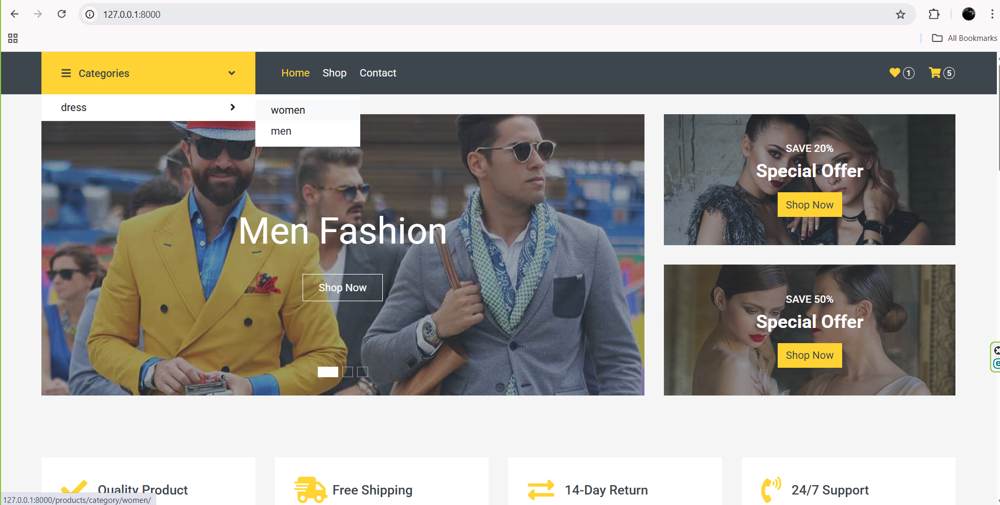
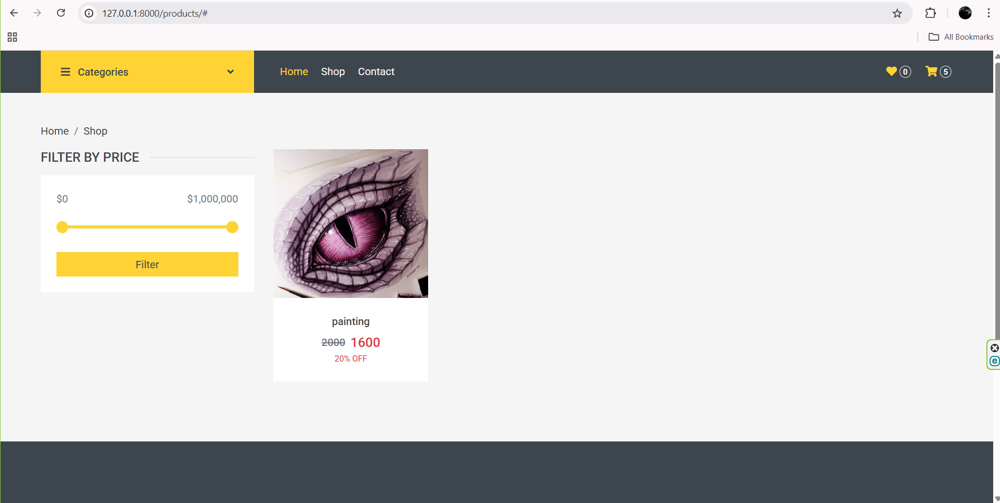
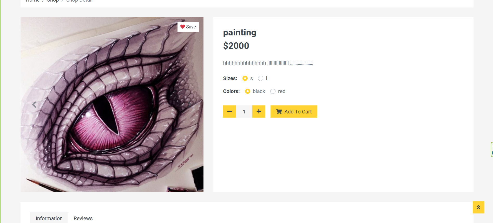
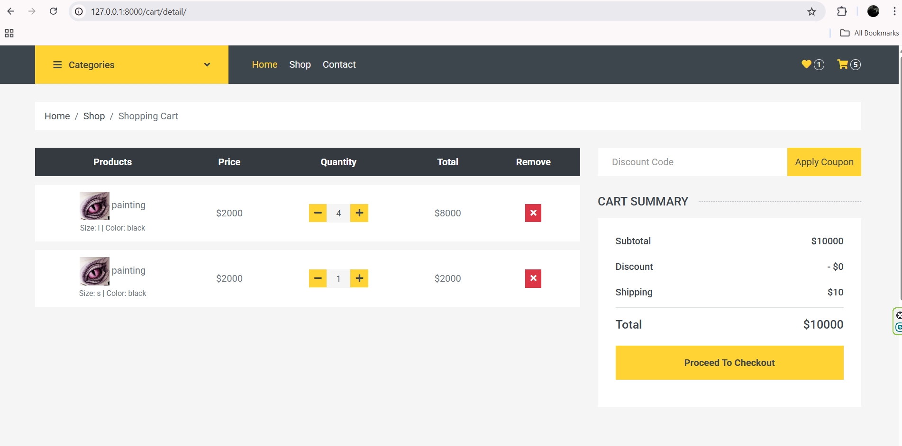
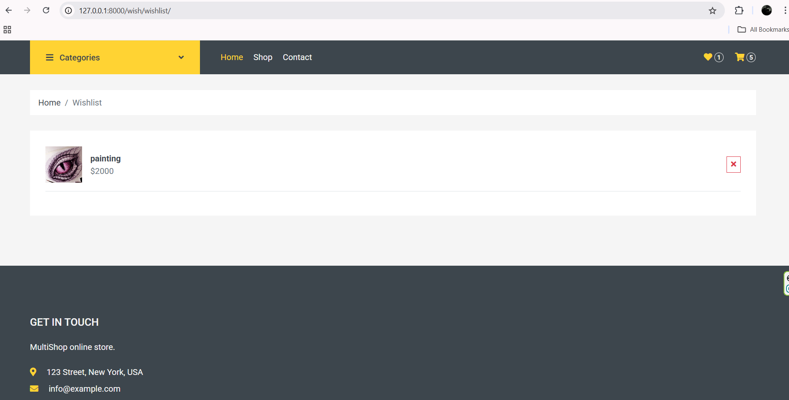
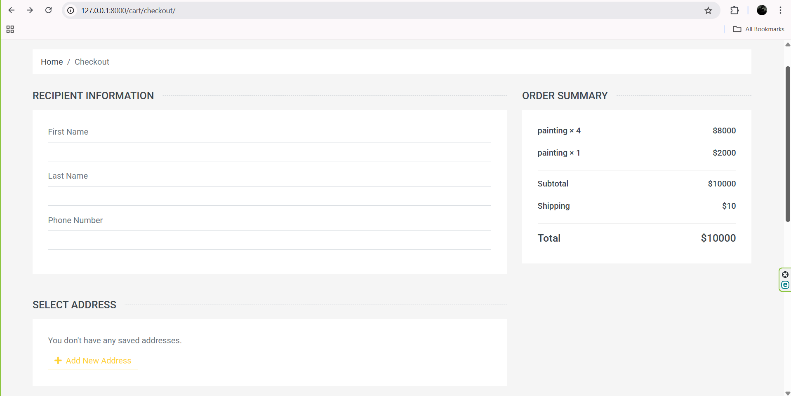
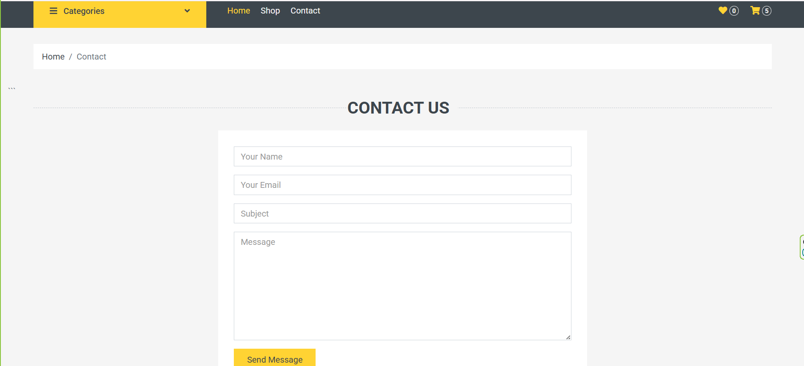

# Django MultiShop

A small online shop built with Django: product catalog, session cart, wishlist, reviews, discount codes, OTP login over SMS, and checkout with cash on delivery or online payment through ZarinPal.

I built it to practice backend fundamentals end to end: models, sessions, authentication, payments, and how a real checkout flow fits together.

## Features

- **Catalog** — nested categories, price filter, pagination, multiple sizes and colors, gallery images, and related products on the detail page
- **Cart** — session-based, tracks quantity, size and color per item, with a live item count in the navbar
- **Wishlist** — save a product with one click (no size or color needed), remove it by clicking again or from the wishlist page, with its own count badge
- **Reviews** — logged-in users can leave comments on a product
- **Discount codes** — percentage codes applied to the cart total
- **OTP login** — phone number + SMS verification code (Ghasedak), no password needed
- **Address book** — multiple saved addresses per user, exact duplicates are rejected
- **Checkout** — recipient details (can differ from the account owner), address selection, and cash on delivery or ZarinPal
- **Orders** — stored with their line items, prices, sizes and colors, and only visible to the user who placed them

## Screenshots

**Home page**


**Categories menu**


**Products list**


**Product detail**


**Shopping cart**


**Wishlist**


**Checkout**


**Contact us**


## Tech stack

- Python 3.13, Django 6.1
- SQLite (development)
- Django sessions for cart state
- Ghasedak SMS API (OTP delivery)
- ZarinPal (online payment)
- Frontend based on the free MultiShop template by HTML Codex (Bootstrap 4), adapted to Django templates with some updates

## Project structure

```
multi_shop/       # project settings and root urls
account/          # user model, OTP auth, addresses
product/          # products, categories, sizes, colors, reviews
cart/             # cart, checkout, orders, discounts, ZarinPal
wishlist/         # saved products
home/             # landing and contact pages
templates/        # shared templates (base layout)
statics/          # CSS, JS, images
screenshots/      # images used in this README
```

Each app owns its own models, views, and URLs, and is wired together through `multi_shop/urls.py`.

## Running it locally

```bash
git clone https://github.com/Beirami13/django-multishop.git
cd django-multishop
python -m venv .venv
.venv\Scripts\activate          # Windows
# source .venv/bin/activate     # macOS / Linux
pip install -r requirements.txt

python manage.py migrate
python manage.py createsuperuser
python manage.py runserver
```

The shop starts empty. Log in to `/admin/` with the superuser and add a few categories, sizes, colors and products to see the catalog.

OTP codes are sent with Ghasedak and online payments go through ZarinPal, so both need your own credentials.

## What's next

Things I know are missing or worth doing better, in roughly the order I plan to tackle them:

- **User profile page** — a page listing a user's past orders and saved addresses in one place, instead of only being able to view a single order by its link
- **Moving the SMS API key out of the code** — it's currently hardcoded in the view instead of read from an environment variable
- **Basic tests** — at least for the cart logic (adding items, calculating totals) and the main checkout flow, since that's the part most likely to break silently

## Notes

This started as a way to practice Django end to end rather than a production shop: the OTP flow, cart, and checkout were all built and debugged incrementally, one feature and one bug at a time. Things like address validation, per-account limits, ownership checks on orders, and duplicate-prevention were added along the way as the checkout flow got fleshed out.

## Roadmap

User profile page with order history
Product search (the navbar search box is not connected yet)
Tests for the cart and checkout flow
